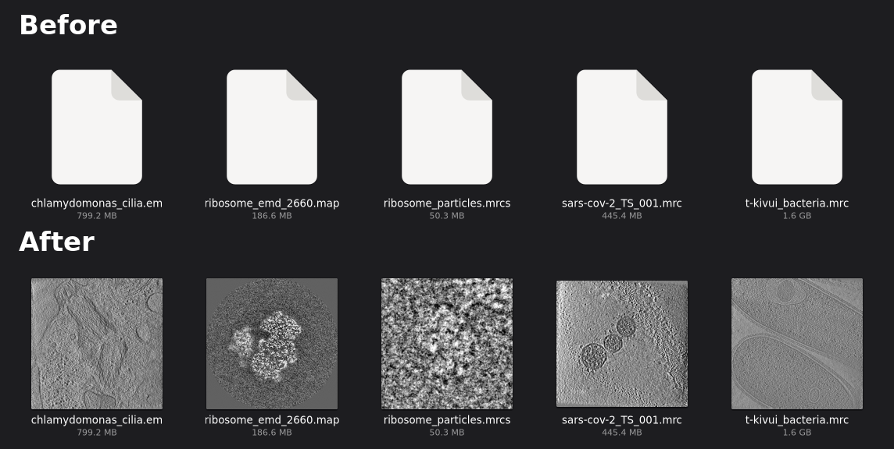

# mrc-em-gnome-thumbnailer

[](https://github.com/the-lay/mrc-em-gnome-thumbnailer/actions/workflows/test.yml)

Thumbnails for cryo-EM and cryo-ET files in your Linux file manager: MRC2014 (`.mrc`, `.mrcs`, `.map`, ...) and EM (`.em`). Each thumbnail shows the central slice with automatic contrast stretching.



Works with GNOME Files (Nautilus), Nemo, Caja, Thunar and Dolphin (KDE Frameworks 6.6 or newer). Tested with Nautilus on Ubuntu 22.04, 24.04 and 26.04, Debian 13, Fedora 44 and Arch Linux, and with the other file managers on Ubuntu 26.04.

Upgrading from the 2021 version? Install the dependencies from step 1, run `git pull` and `sudo make install` in your clone, then [clear the failed thumbnails](#no-thumbnails-for-files-you-opened-before).

# Installation
1. Install numpy and Pillow from your distribution's packages:
   - Ubuntu/Debian: `sudo apt install python3-numpy python3-pil`
   - Fedora: `sudo dnf install python3-numpy python3-pillow`
   - Arch: `sudo pacman -S python-numpy python-pillow`
2. Clone the repository and install:
   ```
   git clone https://github.com/the-lay/mrc-em-gnome-thumbnailer.git
   cd mrc-em-gnome-thumbnailer
   sudo make install
   ```
3. Restart your file manager, for example with `nautilus -q`.

To uninstall, run `sudo make uninstall` in the same folder.

The dependencies come from your distribution and not from pip, because GNOME runs thumbnailers in a sandbox that can only see `/usr`, and current distributions block system-wide pip installs ([PEP 668](https://peps.python.org/pep-0668/)).

# Supported files
- MRC2014: `.mrc`, `.mrcs`, and any other MRC file with the standard `MAP ` stamp in its header (`.map`, IMOD's `.rec`/`.st`/`.ali`, ...). Modes 0, 1, 2, 6 and 12. 2D images, 3D volumes and volume stacks.
- EM: `.em` with 8/16/32-bit integer or 32/64-bit float data.

# Troubleshooting
#### No thumbnails for files you opened before
File managers remember files they failed to thumbnail (for example, with an older version of this thumbnailer) and do not try again. Clear the list of failures and restart the file manager:
```
rm -r ~/.cache/thumbnails/fail
nautilus -q
```

#### Nemo shows no thumbnails for large files
Nemo only thumbnails files smaller than 1 MB by default, which rules out almost every tomogram. Raise the limit, for example to 64 GB:
```
gsettings set org.nemo.preferences thumbnail-limit 68719476736
```

#### Checking a single file
Run the thumbnailer by hand to see the error message: `mrc-em-thumbnailer path/to/file.mrc /tmp/thumbnail.png 256`

# Development
- Unit tests, with [uv](https://docs.astral.sh/uv/): `uv run test_thumbnailer.py`
- Integration test through GNOME's own thumbnail factory, after `sudo make install`: `python3 test_gnome.py`
  (needs `python3-gi gir1.2-gnomedesktop-4.0` on Ubuntu/Debian)

GitHub Actions runs both on every push, and monthly on Ubuntu 22.04, 24.04 and 26.04 to catch distribution updates that break the thumbnailer.

# Demo data
The screenshot above shows public data: SARS-CoV-2 virions ([CZ cryoET Data Portal 10006](https://cryoetdataportal.czscience.com/datasets/10006)), *T. kivui* bacteria ([10008](https://cryoetdataportal.czscience.com/datasets/10008)), *C. reinhardtii* cilia ([10009](https://cryoetdataportal.czscience.com/datasets/10009), converted to `.em`), the *P. falciparum* 80S ribosome map [EMD-2660](https://www.ebi.ac.uk/emdb/EMD-2660) and its particles from [EMPIAR-10028](https://www.ebi.ac.uk/empiar/EMPIAR-10028/).
